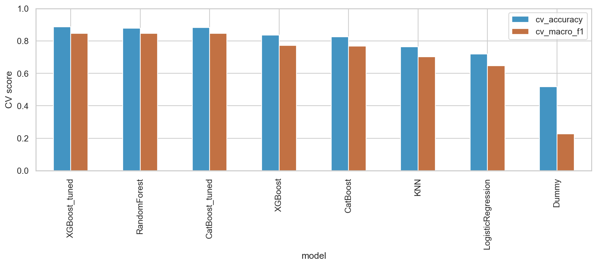
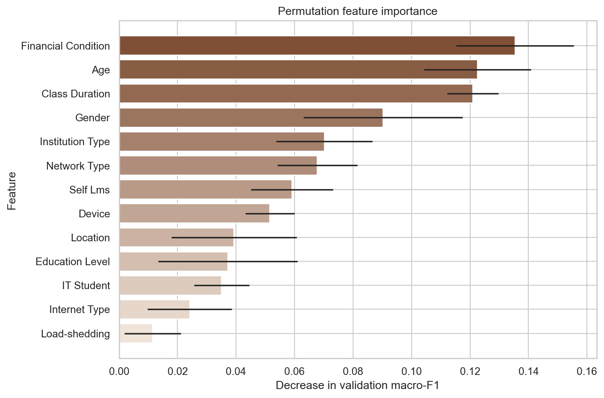
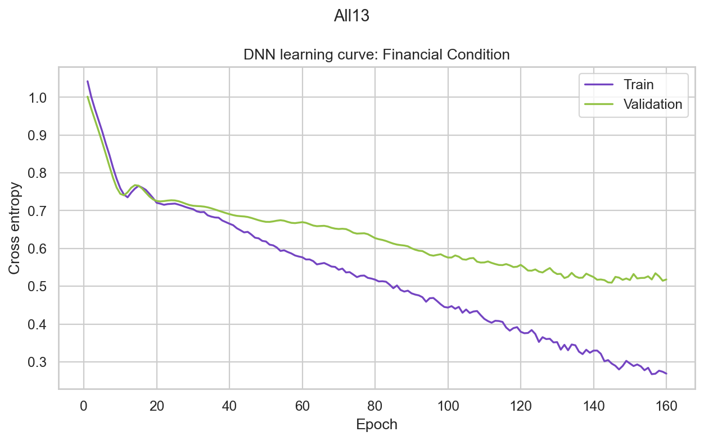
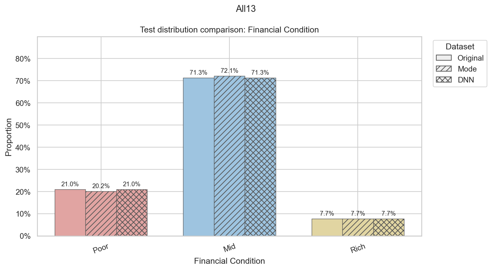
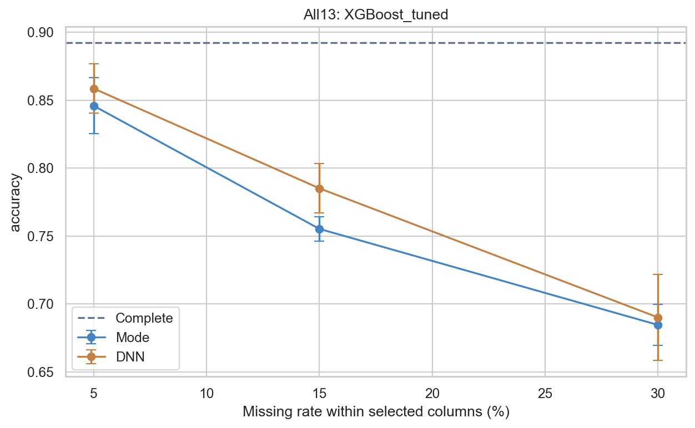
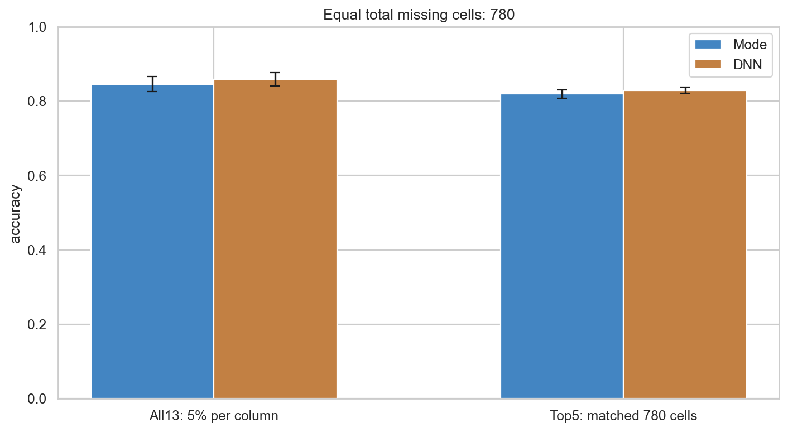

# Online Education Adaptivity: Classification and Missing-Data Robustness

[English](README.md) | [한국어](README.ko.md) | [简体中文](README.zh-CN.md)

A machine-learning course project with two experiments: predicting students' online education adaptivity and evaluating how missing-value imputation changes data distributions and model performance. **My contribution: supplementary-study design, experiment code, evaluation, and visualization.**

## Project Overview

The project consists of a main experiment on complete data and a supplementary experiment on artificially incomplete data.

### Main Experiment: Predicting Online Education Adaptivity

- **Problem:** Examine whether students' backgrounds and online learning environments can be used to predict their adaptivity level: Low, Moderate, or High.
- **Approach:** Analyze 1,205 records through EDA, compare multiple machine-learning classifiers using cross-validation, and tune XGBoost and CatBoost with Optuna. Evaluate the selected model on a held-out test set using accuracy, macro-F1, and balanced accuracy.
- **What You Can Do:** Explore feature distributions and associations, compare classifiers and tuning results, and assess how accurately the models predict adaptivity from complete inputs. These results also provide the reference for the supplementary experiment.

### Supplementary Experiment: Imputation Under Missing Data

- **Problem:** Real-world data can be incomplete, whereas the supplied dataset contains no missing values. Investigate how incomplete inputs and subsequent imputation change data distributions and prediction performance relative to the main experiment.
- **Approach:** Randomly mask values in all 13 features or the five most important features, impute them using a per-feature DNN, and compare against mode imputation. Repeat across missingness rates and masks, comparing reconstructed distributions and downstream classifier performance with the original complete-data results.
- **What You Can Do:** Compare original, Mode, and DNN distributions; measure reconstruction accuracy on masked cells; and examine how missingness rate and concentration affect the gap from complete-data model performance.

## Key Results and Visual Evidence

- **Project baseline:** CV-selected tuned XGBoost achieved **89.23% test accuracy and 0.8773 macro-F1** on 362 complete-data test rows.
- **Supplementary study:** In the primary All13 experiment at 5% missingness per feature, reconstruction accuracy on masked test cells was **82.17% for DNN versus 69.13% for Mode**.
- **Robustness:** Mean DNN-based classification accuracy in All13 decreased from **85.86% to 78.51% to 69.01%** at 5%, 15%, and 30% missingness. Each mean uses five masks on the same split.
- **Uncertainty:** DNN had higher mean classification scores in all six scenario/rate settings, but the primary 5% performance-difference confidence intervals included zero.

<details>
<summary>View six representative figures</summary>

**1. Complete-data model comparison.** Five-fold training CV scores provide the model-selection baseline.



**2. Feature selection for Top5.** Permutation importance is measured on a validation subset within training; error bars show standard deviations over eight permutations.



**3. DNN training diagnostic.** Cross-entropy curves for Financial Condition illustrate the internal validation used to select the training epoch count.



**4. Distribution comparison.** Original, Mode, and DNN test distributions share category colors and use different hatches. Distributional similarity complements cell-level reconstruction accuracy.



**5. Missingness-rate sensitivity.** Points are means across five masks; error bars show standard deviations. The dashed line is complete-data test accuracy.



**6. Equal missing-cell budget.** Both settings mask 780 cells, comparing distributed missingness with concentration in Top5; error bars show standard deviations across five masks.



</details>

## My Contribution

The project-level workflow covers EDA, classifier comparison, and hyperparameter tuning. I was responsible for the **supplementary study**:

- Designed and coded the All13/Top5 masking framework, repeated evaluation across rates and masks, and the equal-budget comparison. Evidence: [notebook](analysis.ipynb), [mask-run results](experiment_results/robustness_all_runs.csv), and [equal-budget results](experiment_results/matched_budget_all_runs.csv).
- Implemented mode imputation and a per-feature categorical DNN imputer, including training-only fitting, internal validation, and preservation of observed values. Evidence: `CategoricalDNNImputer` and `mode_impute_pair` in the notebook.
- Evaluated masked-cell reconstruction and downstream classification, calculated paired-bootstrap intervals, and examined generalization using profile-group validation. Evidence: [reconstruction scores](experiment_results/All13/imputation_quality.csv), [bootstrap intervals](experiment_results/primary_paired_bootstrap.csv), and [group validation](experiment_results/profile_group_test.csv).
- Built distribution comparisons, learning curves, sensitivity plots, and CSV exports linking visual conclusions to recorded results.

## Data and Preprocessing

- **Data:** 1,205 rows, 13 categorical predictors, and the target `Adaptivity Level`: Low 480, Moderate 625, High 100.
- **Audit:** No original missing cells; 949 duplicate full rows beyond their first occurrences; 236 unique input profiles, including 19 profiles with conflicting labels. Rows are retained because identical responses do not establish respondent identity.
- **Split:** Stratified 70:30 row split, seed 42: 843 training and 362 test rows. EDA and importance analysis use the training portion.
- **Encoding:** Strip whitespace; one-hot encode categorical features within CV folds. Standardize encoded inputs for Logistic Regression and KNN.

## Method and Technical Choices

### Complete-data baseline

Compare a majority-class Dummy baseline, Logistic Regression, KNN, Random Forest, XGBoost, and CatBoost. Tune XGBoost and CatBoost with Optuna, using 12 trials per model and the same five stratified CV folds. Select by macro-F1 to give each target class equal weight; also report accuracy and balanced accuracy.

Cramer's V describes categorical association. Permutation importance measures the validation macro-F1 decrease after shuffling a feature. The latter selects **Financial Condition, Age, Class Duration, Gender, and Institution Type** for Top5 without using the test set.

### Supplementary experiment

1. Generate random MCAR masks, excluding the target. All13 masks every predictor; Top5 masks the fixed importance-selected subset. At 5% per selected feature, these settings remove 780 and 300 cells respectively.
2. Fit the mode baseline on training data. For DNN imputation, predict each masked feature from the other 12 features using one-hot inputs, mode filling of missing inputs, and missingness indicators.
3. Use a PyTorch network with 64 and 32 hidden units, ReLU, dropout 0.1, cross-entropy, and Adam. An internal 80:20 split selects the epoch count, with a maximum of 160 epochs and patience 18; refit on all observed training rows for the selected count.
4. Preserve observed values and use hidden original values only for evaluation. Refit downstream classifiers with parameters fixed by complete-data CV.
5. Repeat at 5%, 15%, and 30% using mask seeds 42–46, holding the row split and DNN initialization fixed. Match the total budget at 780 cells in an additional comparison: All13 at 5% versus 156 masked cells per Top5 feature.

## Evaluation and Results

### Primary All13 run

Seed 42; 5% missingness per feature; the same 362 test rows and tuned XGBoost configuration for all conditions. Reconstruction accuracy aggregates correctly recovered masked test cells across features, weighted by masked-cell counts.

| Condition | Test accuracy | Test macro-F1 |
|---|---:|---:|
| Complete | 89.23% | 0.8773 |
| Mode | 82.04% | 0.7898 |
| DNN | 84.25% | 0.7975 |

Reconstruction accuracy: **DNN 82.17%, Mode 69.13%**. Source: [classification results](experiment_results/primary_classification_comparison.csv) and [imputation scores](experiment_results/All13/imputation_quality.csv).

Using 1,000 paired test-row bootstrap resamples, the DNN−Mode accuracy difference was **+2.21 percentage points (95% interval: −1.10 to +5.53)**. The macro-F1 difference was **+0.77 percentage points (−3.80 to +5.42)**. Both include zero. [Intervals](experiment_results/primary_paired_bootstrap.csv)

### Repeated missingness experiments

Accuracy below is reported as **mean percentage ± standard deviation in percentage points** across five masks. The split and tuned XGBoost configuration are fixed; these deviations describe mask variability.

| Scenario | Missingness per selected feature | Mode accuracy | DNN accuracy |
|---|---:|---:|---:|
| All13 | 5% | 84.59 ± 2.05 | 85.86 ± 1.81 |
| All13 | 15% | 75.52 ± 0.89 | 78.51 ± 1.83 |
| All13 | 30% | 68.45 ± 1.51 | 69.01 ± 3.17 |
| Top5 | 5% | 86.41 ± 0.60 | 87.07 ± 0.90 |
| Top5 | 15% | 81.27 ± 1.32 | 82.04 ± 2.49 |
| Top5 | 30% | 76.57 ± 1.41 | 78.23 ± 3.34 |

Both mean accuracy and mean macro-F1 were higher for DNN in all six settings. These are descriptive repeated-mask results. [Run-level records](experiment_results/robustness_all_runs.csv) · [Summary](experiment_results/robustness_summary.csv)

### Concentration and unseen profiles

- **Equal budget:** With 780 masked cells, DNN mean accuracy was **85.86% ± 1.81 percentage points** for All13 and **82.93% ± 0.84 percentage points** for concentrated Top5 missingness. This comparison reflects both the affected features and the concentration of damage. [Results](experiment_results/matched_budget_all_runs.csv)
- **Profile-group validation:** A separate 846/359 train/test split kept identical input profiles together. Group CV selected Logistic Regression, whose complete-data test accuracy was **69.64%**, with macro-F1 **0.6111**. Both the split and model differ from the standard baseline, so the entire gap cannot be attributed to profile overlap. [Results](experiment_results/profile_group_test.csv)

## Installation and Execution

The recorded run used **Python 3.13.2 on Windows with CPU PyTorch**. Install the recorded dependencies and open JupyterLab from this directory:

```bash
python -m pip install -r requirements.txt
python -m pip install jupyterlab
python -m jupyterlab
```

Place `students_adaptability_level_online_education.csv` beside `analysis.ipynb`, open the notebook, and run all cells in order. The notebook checks the expected shape of 1,205 rows and 14 columns and writes regenerated outputs to `experiment_results/`. Saved notebook outputs and CSVs can also be inspected directly.

## Directory Structure

```text
.
├── README.md
├── README.ko.md
├── README.zh-CN.md
├── analysis.ipynb
├── requirements.txt
├── students_adaptability_level_online_education.csv
├── .gitignore
└── experiment_results/
    ├── clean_test_scores.csv
    ├── primary_classification_comparison.csv
    ├── primary_paired_bootstrap.csv
    ├── robustness_all_runs.csv
    ├── robustness_summary.csv
    ├── matched_budget_all_runs.csv
    ├── profile_group_test.csv
    ├── top5_selection.csv
    ├── All13/imputation_quality.csv
    └── figures/
```

## Limitations and Next Steps

- Synthetic MCAR masks simplify real missingness. Future experiments could evaluate MAR/MNAR patterns and independently sourced data.
- Repeated-mask standard deviations do not capture uncertainty across independent datasets or splits. Bootstrap intervals are conditional on the fitted models, split, and primary masks; repeated profiles also limit row independence.
- All13 and Top5 at the same per-feature rate remove different numbers of cells. Equal-budget matching controls the total count but not missingness concentration.
- Top5 is specific to the selected model and internal validation sample. Categorical association and permutation importance do not establish causal effects.
- The profile-group result highlights the need for broader generalization checks. The 12-trial tuning budget is limited; future work could use nested CV and a wider imputation benchmark.

## Artifacts and Reference Materials

[English notebook](analysis.ipynb) · [Recorded environment](experiment_results/environment.json) · [Model-selection ranking](experiment_results/cv_ranking.csv) · [Top5 selection](experiment_results/top5_selection.csv) · [Recorded verification](experiment_results/verification.json)
