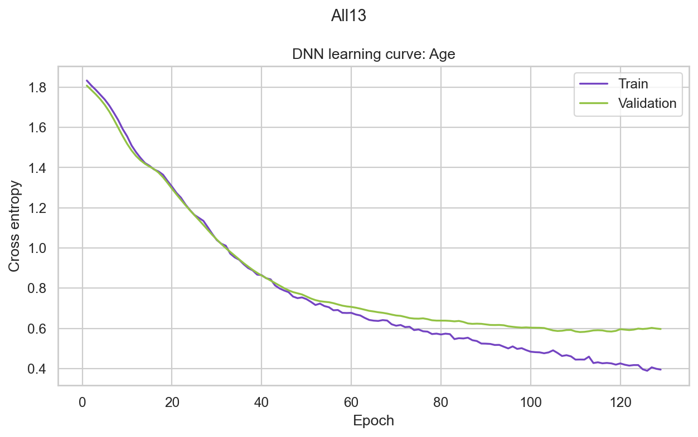
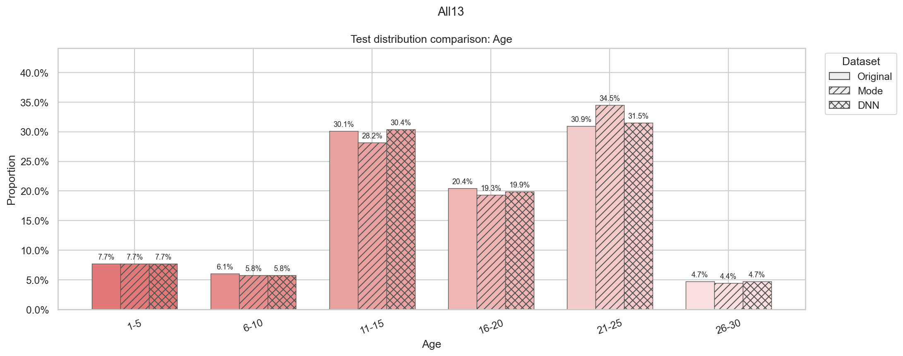

# 在线教育适应水平预测：分类模型与缺失数据稳健性分析

[English](README.md) | [한국어](README.ko.md) | [简体中文](README.zh-CN.md)

机器学习课程项目，由预测学生在线教育适应水平的主实验，以及评估缺失值填补后数据分布与模型性能变化的补充实验组成。

**个人贡献：补充实验设计、实验代码编写、评估与可视化。**

## 1 项目概述

项目主要由使用无缺失数据的**主实验**，以及人为引入缺失值的**补充实验**组成。

### 1.1 主实验：在线教育适应水平预测

- **问题定义：** 探索能否根据学生背景与在线学习环境，将在线教育适应水平预测为Low、Moderate或High。
- **解决方法：** 对1,205条回答开展EDA，通过交叉验证比较多种机器学习分类器，并使用Optuna调优XGBoost和CatBoost的超参数。随后在独立测试集上，以准确率、macro-F1和balanced accuracy评估所选模型。EDA发现各类别样本数量不均衡，因此加入balanced accuracy，以检查模型对少数类别的预测表现。
- **成果用途：** 探索特征分布与关联，比较模型性能及调参结果，并判断在完整输入下预测适应水平的准确程度。这些结果也作为补充实验的基线。

### 1.2 补充实验：缺失值填补后的变化分析

- **问题定义：** 提供的数据是没有缺失值的完整数据，但在许多现实场景中，无缺失的完整数据往往难以获得。因此，通过随机抽样人为生成缺失值，再考察输入信息缺失及后续填补相较于主实验，会如何改变数据分布与预测性能。
- **解决方法：** 分别对全部13个特征和重要性最高的5个特征随机引入缺失，比较逐特征DNN填补与众数填补。改变缺失比例与掩码重复实验，将恢复后的分布和下游分类性能与原始无缺失数据结果比较。
- **成果用途：** 比较Original、Mode和DNN的分布，测量被遮蔽单元格的恢复准确率，并分析缺失比例与缺失集中程度如何影响其与无缺失数据模型性能之间的差距。

## 2 主要结果与代表性图表

- **项目基线：** 通过CV选出的调优XGBoost在362条完整数据测试记录上取得了**89.23%的准确率和0.8773的macro-F1**。
- **补充实验：** 在All13每个特征缺失5%的主实验中，被遮蔽测试单元格的恢复准确率为**DNN 82.17%、众数填补69.13%**。
- **稳健性：** All13中，DNN填补后的平均分类准确率在缺失比例为5%、15%、30%时依次降至**85.86%、78.51%、69.01%**。每个均值来自固定划分下的5个掩码。
- **不确定性：** 在两种场景、三种缺失比例共6种条件下，DNN的平均分类得分更高，但主5%实验的性能差异置信区间包含0。

**1. 无缺失数据模型比较。** 使用训练集的5-fold CV得分作为模型选择依据。图中可以看出，XGBoost_tuned取得了最高性能。


**2. Top5特征选择。** 在训练数据内部的验证子集上计算置换重要性。误差线表示8次置换的标准差。以交叉验证macro-F1最高的`XGBoost_tuned`为基准，选出重要性最高的5个特征，并在补充实验中随机将这些特征的部分值设为缺失，评估其对恢复准确率与分类性能的影响。


**3. DNN训练诊断。** 数据集中13个特征的交叉熵曲线展示了用于确定训练epoch数的内部验证过程。示例图为Age的交叉熵曲线，其余特征的交叉熵曲线可在experiment_results/figures中查看。



**4. 分布比较。** Original、Mode和DNN测试分布使用一致的类别颜色，以不同填充纹理区分。分布相似性结合单元格级恢复准确率进行解读。整体上，DNN填补后的分布比众数填补更接近原始数据集分布。下图为Age特征的测试分布，其他特征的测试分布图可在experiment_results/figures中查看。



**5. 缺失比例敏感性。** 点表示5个掩码的均值，误差线表示标准差，虚线表示无缺失数据的测试准确率。DNN填补的准确率高于众数填补；随着缺失比例增加，两种方法的准确率均呈下降趋势。


**6. 相同缺失总量比较。** 两种条件均遮蔽780个单元格，对比分散于全部特征的缺失与集中于Top5的缺失。误差线表示5个掩码的标准差。无论是在全部13个特征中随机引入缺失，还是将相同数量的缺失集中到对模型性能影响较大的5个特征，DNN的表现均高于众数填补。


## 3 个人贡献

项目整体流程包括EDA、分类模型比较和超参数调优。其中，我负责**补充实验**：

- 设计并编写All13/Top5缺失掩码框架、跨缺失比例与掩码的重复评估，以及相同缺失总量比较。依据：[Notebook](analysis.ipynb)、[各掩码结果](experiment_results/robustness_all_runs.csv)和[相同缺失总量结果](experiment_results/matched_budget_all_runs.csv)。
- 实现众数填补与逐特征类别型DNN填补器，仅在训练数据上拟合，通过内部验证确定训练量，并保留所有观测值。依据：Notebook中的`CategoricalDNNImputer`与`mode_impute_pair`。
- 评估被遮蔽单元格的恢复情况及下游分类性能，计算配对bootstrap区间，并通过输入画像分组验证考察泛化能力。依据：[恢复得分](experiment_results/All13/imputation_quality.csv)、[bootstrap区间](experiment_results/primary_paired_bootstrap.csv)和[分组验证](experiment_results/profile_group_test.csv)。
- 制作分布比较、学习曲线和敏感性图表，并导出CSV，使图表结论能够对应到已记录的结果。

## 4 数据与预处理

- **数据：** 1,205行、13个类别型输入特征，目标列为`Adaptivity Level`。Low、Moderate、High分别有480、625、100条记录。
- **数据审查：** 原始数据没有缺失值；首次出现之后的完全重复行有949行。共有236种不同输入画像，其中19种对应不同目标标签。相同回答不足以证明受访者身份相同，因此保留这些记录。
- **划分：** 使用seed 42进行分层70:30行划分，训练集843行、测试集362行。EDA和重要性分析在训练部分进行。
- **编码：** 清理首尾空格，在每个CV折内部拟合独热编码器；对Logistic Regression和KNN的编码输入进行标准化。

## 5 方法与技术选择依据

### 5.1 无缺失数据基线模型

比较多数类Dummy基线、Logistic Regression、KNN、Random Forest、XGBoost和CatBoost。使用相同的5个分层CV折，通过Optuna分别对XGBoost和CatBoost进行12次trial。以各类别等权的macro-F1选择模型，同时报告准确率和balanced accuracy。

Cramer's V衡量类别变量间的关联；置换重要性衡量打乱某特征后验证macro-F1的下降幅度。使用后者，在不使用测试集的情况下选出Top5：**Financial Condition、Age、Class Duration、Gender、Institution Type**。

### 5.2 补充实验

1. 排除目标列，生成随机MCAR缺失掩码。All13覆盖全部输入特征，Top5覆盖固定的重要性特征子集。每个选中特征缺失5%时，分别遮蔽780和300个单元格。
2. 在训练数据上拟合众数填补基线。DNN使用其余12个特征预测每个待填补特征，输入采用独热编码，并对输入缺失进行众数填补、加入缺失指示变量。
3. 使用PyTorch网络，隐藏层为64和32个单元，采用ReLU、dropout 0.1、交叉熵及Adam。内部80:20划分以最多160 epochs、patience 18选择训练轮数，再以选定轮数在全部已观测训练行上重新训练。
4. 保留观测值，被遮蔽的原始值仅用于评估。下游分类器固定完整数据CV选出的参数，并在各条件下重新拟合。
5. 固定行划分与DNN初始化，使用5%、15%、30%的缺失比例和掩码seed 42–46重复实验。额外比较将总量统一为780个单元格：All13为5%，Top5每个特征遮蔽156个单元格。

## 6 评估方法与结果

### 6.1 All13主运行

使用seed 42，每个特征缺失5%；所有条件使用相同的362条测试记录及调优XGBoost配置。恢复准确率按各特征被遮蔽单元格数加权，汇总全部被遮蔽测试单元格的正确恢复比例。

| 条件 | 测试准确率 | 测试macro-F1 |
|---|---:|---:|
| Complete | 89.23% | 0.8773 |
| Mode | 82.04% | 0.7898 |
| DNN | 84.25% | 0.7975 |

恢复准确率为**DNN 82.17%、众数填补69.13%**。依据：[分类结果](experiment_results/primary_classification_comparison.csv)和[填补得分](experiment_results/All13/imputation_quality.csv)。

对相同测试行进行1,000次配对bootstrap重采样后，DNN−Mode的准确率差为**+2.21个百分点，95%区间为−1.10至+5.53个百分点**；macro-F1差为**+0.77个百分点，区间为−3.80至+5.42个百分点**。两个区间均包含0。[区间结果](experiment_results/primary_paired_bootstrap.csv)

### 6.2 重复缺失实验

下表准确率为5个掩码的**均值（%）±标准差（百分点）**。数据划分和调优XGBoost配置固定，标准差反映掩码变化。

| 场景 | 每个选中特征的缺失比例 | 众数准确率 | DNN准确率 |
|---|---:|---:|---:|
| All13 | 5% | 84.59 ± 2.05 | 85.86 ± 1.81 |
| All13 | 15% | 75.52 ± 0.89 | 78.51 ± 1.83 |
| All13 | 30% | 68.45 ± 1.51 | 69.01 ± 3.17 |
| Top5 | 5% | 86.41 ± 0.60 | 87.07 ± 0.90 |
| Top5 | 15% | 81.27 ± 1.32 | 82.04 ± 2.49 |
| Top5 | 30% | 76.57 ± 1.41 | 78.23 ± 3.34 |

6种条件下，DNN的平均准确率和平均macro-F1均更高。这些结果是对重复掩码实验的描述性汇总。[逐次运行记录](experiment_results/robustness_all_runs.csv) · [汇总](experiment_results/robustness_summary.csv)

### 6.3 缺失集中程度与新输入画像

- **相同总量：** 遮蔽780个单元格时，DNN平均准确率在All13中为**85.86% ± 1.81个百分点**，在Top5集中缺失中为**82.93% ± 0.84个百分点**。该比较同时涉及受损特征与缺失集中程度的变化。[结果](experiment_results/matched_budget_all_runs.csv)
- **输入画像分组验证：** 单独划分846条训练记录和359条测试记录，将相同输入画像保留在同一侧。通过分组CV选择的Logistic Regression在完整数据上的测试准确率为**69.64%，macro-F1为0.6111**。划分和模型均与原基线不同，因此不能将全部差距归因于输入画像重叠。[结果](experiment_results/profile_group_test.csv)

## 7 安装与运行

记录的运行环境为**Windows、Python 3.13.2、CPU PyTorch**。在当前目录安装已记录的依赖并启动JupyterLab：

```bash
python -m pip install -r requirements.txt
python -m pip install jupyterlab
python -m jupyterlab
```

将`students_adaptability_level_online_education.csv`与`analysis.ipynb`放在同一目录，打开Notebook并按顺序运行全部单元格。Notebook会检查1,205行、14列的预期结构，并将重新生成的结果写入`experiment_results/`。也可以直接查看已保存的Notebook输出和CSV。

## 8 主要目录结构

```text
.
├── README.md
├── README.ko.md
├── README.zh-CN.md
├── analysis.ipynb
├── requirements.txt
├── students_adaptability_level_online_education.csv
├── .gitignore
└── experiment_results/
    ├── clean_test_scores.csv
    ├── primary_classification_comparison.csv
    ├── primary_paired_bootstrap.csv
    ├── robustness_all_runs.csv
    ├── robustness_summary.csv
    ├── matched_budget_all_runs.csv
    ├── profile_group_test.csv
    ├── top5_selection.csv
    ├── All13/imputation_quality.csv
    └── figures/
```

## 9 局限与后续方向

- 合成MCAR掩码简化了真实缺失机制。后续可评估MAR/MNAR模式及独立来源的数据。
- 重复掩码的标准差不代表独立数据集或不同划分间的不确定性。Bootstrap区间以已拟合模型、划分和主掩码为条件，重复输入画像也限制了行独立性。
- 在相同逐特征缺失比例下，All13与Top5的缺失单元格数量不同。总量匹配仍未控制缺失集中程度。
- Top5依赖于所选模型和内部验证样本。类别关联与置换重要性不代表因果效应。
- 输入画像分组结果说明需要更广泛的泛化验证。12次trial的调参范围有限；后续可采用嵌套CV，并扩展填补方法基准。

## 10 项目材料与参考依据

[英文Notebook](analysis.ipynb) · [记录的环境](experiment_results/environment.json) · [模型选择排名](experiment_results/cv_ranking.csv) · [Top5选择](experiment_results/top5_selection.csv) · [记录的验证](experiment_results/verification.json)
